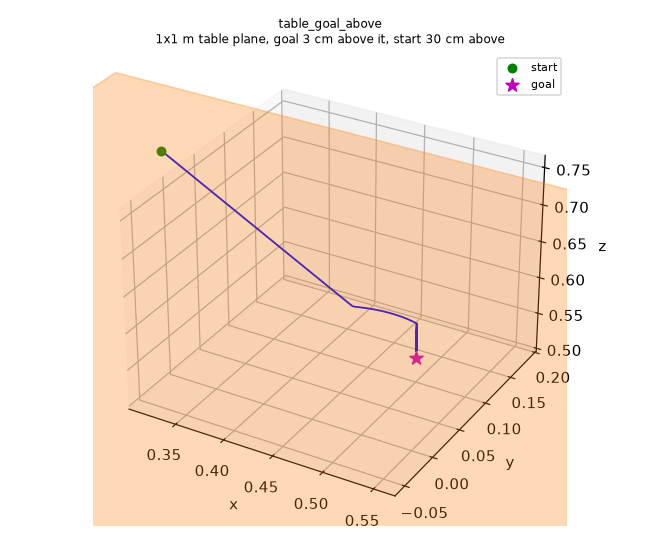
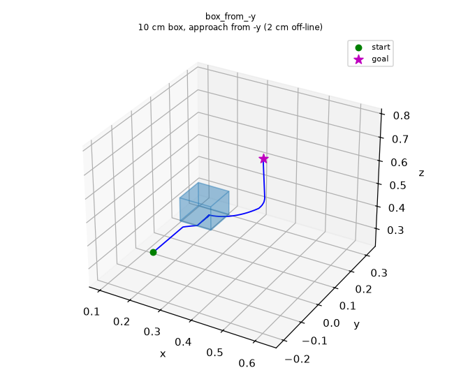
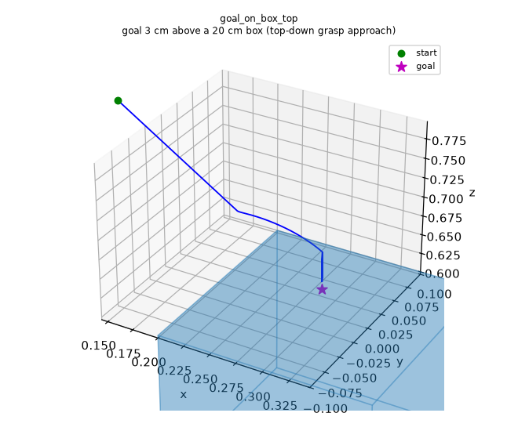
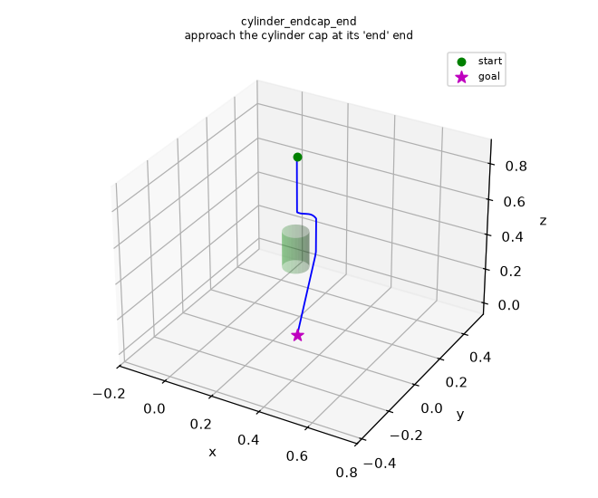
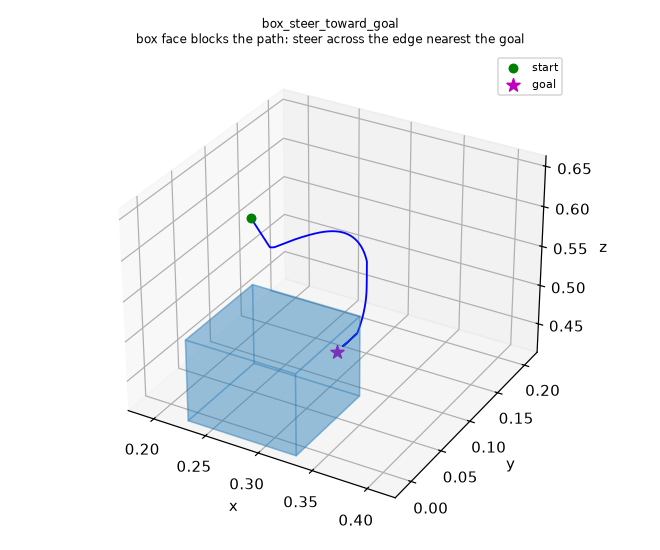
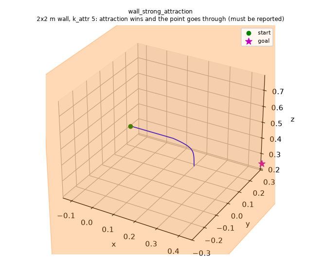

# GeoPF Engineering Report: Flaw Analysis, Solutions & Verification

## Executive Summary

Ten flaws in the original code were fixed across the C++ core (`src/force_*.cpp`, `src/geopf_cli.cpp`, `include/geometry_force.h`) and the Python wrapper (`python/geopf.py`). A code review of that first round found further problems (missed wall crossings, box steering toward the wrong edge, box corner order, units guessed from `goal_tolerance`, a boundary recovery force that never acted). Those are fixed as well and are described below.

Every result was checked against 46 deterministic benchmark scenes and a 100-scene random stress test, using an independent geometry checker (`tests/geometry.py`) that works on the whole trajectory, not only its samples.

### Key Highlights
- **Collision detection along each whole step:** the planner checks every step segment against every obstacle (sphere, line, rectangle, box, cylinder). Passing through a wall, a line, a thin box or a thin cylinder between two samples is reported as `collision`. No benchmark or random scene ends in `FALSE_SUCCESS` (success reported although the path went through an obstacle). Seven regression scenes cover the cases the first round missed.
- **Collinear immunity (F1):** obstacles directly on the start–goal line no longer produce `NaN`.
- **Surface proximity & pre-grasp goals (F2):** goals 1–10 cm above tables, planes and box tops are reached.
- **Boxes (F3):** faces are built correctly for any corner order, and the steering correction heads for the edge nearest the goal, as in the MATLAB reference.
- **Cylinder end caps (F4):** distances at the `end` cap are measured from `obs_end`.
- **Units (F6):** an explicit `length_scale` (scene units per metre) scales the gains and the default distances, so the same scene in millimetres plans the same path. Without it, a millimetre scene still fails.
- **Deterministic penetration handling (F7):** no random walk. Leaving the workspace boundary no longer ends a run; the boundary pulls the point back in.
- **Exact rectangle geometry (F8 & F9):** exact point-in-rectangle tests, for rectangle corners in any order.
- **NumPy input (F10):** one obstacle can be given as a flat list, a nested list or a NumPy array of any shape.

---

## Benchmark Results

"Before" is the original code (`master`), "After" is this branch. Distances are the independent checker's closest approach over the whole trajectory (for boundary scenes: distance to the boundary).

| Scene | Before Verdict | After Verdict | After Status | True Min Dist | Description |
|---|---|---|---|---|---|
| `free_space` | PASS | **PASS** | reached_goal | – | No obstacles baseline |
| `sphere_offset_readme` | PASS | **PASS** | reached_goal | 4.27 cm | Sphere 1 cm off start-goal line |
| `sphere_collinear` | FAIL (`numerical_error`) | **PASS** | reached_goal | 3.91 cm | Sphere directly on line (F1) |
| `sphere_large_r015` | PASS | **PASS** | reached_goal | 3.67 cm | Large sphere (r=0.15 m) |
| `goal_near_sphere` | PASS | **PASS** | reached_goal | 3.00 cm | Goal 2 cm from sphere surface |
| `wall_head_on` | PASS | **PASS** | reached_goal | 3.06 cm | Wall obstacle on direct line |
| `wall_off_centre` | PASS | **PASS** | reached_goal | 3.97 cm | Wall obstacle offset by 3 cm |
| `wall_wide` | PASS | **PASS** | reached_goal | 1.98 cm | 1.0 m wide wall |
| `wall_tilted` | PASS | **PASS** | reached_goal | 4.60 cm | Tilted wall (F8/F9) |
| `wall_tilted_near_miss` | PASS | **PASS** | reached_goal | 9.38 cm | Path passes near tilted wall |
| `table_goal_above` | FAIL (`max_iterations`) | **PASS** | reached_goal | 4.00 cm | Goal 3 cm above 1x1 m table (F2) |
| `table_goal_across` | FAIL (`max_iterations`) | **PASS** | reached_goal | 3.00 cm | Move across table 3 cm above surface (F2) |
| `table_goal_6cm` | FAIL (`max_iterations`) | **PASS** | reached_goal | 7.00 cm | Goal 6 cm above table (F2) |
| `table_goal_9cm` | PASS | **PASS** | reached_goal | 9.90 cm | Goal 9 cm above table |
| `table_goal_11cm` | PASS | **PASS** | reached_goal | 11.64 cm | Goal 11 cm above table |
| `table_as_box_goal_above` | FAIL (`max_iterations`) | **PASS** | reached_goal | 4.00 cm | Goal 3 cm above thin box table (F2) |
| `box_from_-x` | PASS | **PASS** | reached_goal | 0.76 cm | 10 cm box approached from $-x$ |
| `box_from_+x` | PASS (grazed 0.12 mm) | **PASS** | reached_goal | 0.76 cm | 10 cm box approached from $+x$ (F3) |
| `box_from_-y` | **FALSE_SUCCESS** (penetrated) | **PASS** | reached_goal | 0.76 cm | 10 cm box approached from $-y$ (F3/F5) |
| `box_from_+y` | PASS | **PASS** | reached_goal | 0.76 cm | 10 cm box approached from $+y$ |
| `box_from_-z` | PASS | **PASS** | reached_goal | 0.76 cm | 10 cm box approached from $-z$ |
| `box_from_+z` | PASS | **PASS** | reached_goal | 0.76 cm | 10 cm box approached from $+z$ |
| `box_rotated` | PASS | **PASS** | reached_goal | 5.35 cm | 10 cm box rotated 30°/40° |
| `box_corners_binary_order` | PASS (wrong box) | **PASS** | reached_goal | 0.76 cm | Box corners in x/y/z bit order: now identical to `box_from_-x` (F3/F9) |
| `plane_corners_zorder` | PASS (dist mismatch) | **PASS** | reached_goal | 3.06 cm | Wall corners in Z order (F9) |
| `goal_on_box_top` | FAIL (`max_iterations`) | **PASS** | reached_goal | 4.00 cm | Top-down grasp goal above box (F2) |
| `cylinder_side` | PASS | **PASS** | reached_goal | 7.07 cm | Vertical cylinder pole 1 cm off line |
| `cylinder_endcap_start` | PASS | **PASS** | reached_goal | 5.39 cm | Cylinder approached at start cap |
| `cylinder_endcap_end` | PASS (grazed 0.4 mm) | **PASS** | reached_goal | 5.37 cm | Cylinder approached at end cap (F4) |
| `cylinder_endcap_end_offaxis`| PASS (grazed 0.7 mm) | **PASS** | reached_goal | 6.32 cm | Cylinder approached 3 cm off axis (F4) |
| `cylinder_large_r015` | PASS | **PASS** | reached_goal | 5.22 cm | Fat cylinder (r=0.15 m) |
| `line_bar` | FAIL (`numerical_error`) | **PASS** | reached_goal | 4.40 cm | Line segment bar crossing path (F1) |
| `boundary_tight` | FAIL (`numerical_error` @ it 2)| **PASS** | reached_goal | 2.00 cm | Boundary centred on line (F1) |
| `boundary_offcentre` | PASS | **PASS** | reached_goal | 1.98 cm | Boundary offset by 1 cm |
| `start_outside_boundary` | FAIL (random walk) | **PASS** | reached_goal | -2.00 cm (start) | Starts 2 cm outside the workspace, is pulled back in (F7) |
| `scaled_x10_sphere` | PASS | **PASS** | reached_goal | 3.64 cm | Scene scaled x10 (default parameters) |
| `millimetres_sphere` | FAIL (`collision`) | **FAIL** (expected) | max_iterations | 236.7 mm | Millimetre scene without `length_scale`: metre-sized influence distances are far too small |
| `millimetres_sphere_length_scale` | – | **PASS** | reached_goal | 42.67 mm | Same scene with `length_scale: 1000`: exactly `sphere_offset_readme` x1000 (F6) |
| `concave_cup` | PASS | **PASS** | reached_goal | 3.05 cm | 3-wall concave local minimum trap |

### Regression scenes from the code review

"Before" here is the first round of fixes (commit `5809805`). COLLISION means the planner stopped with `collision` and the independent check confirms the path went through the obstacle, which is the correct outcome for these scenes.

| Scene | Before | After | Description |
|---|---|---|---|
| `wall_strong_attraction` | **FALSE_SUCCESS** | **COLLISION** | 2x2 m wall, `k_attr 5`: the point passes the wall within 0.04 mm and the old sign test (`h_last * h_cur < -1e-8`) missed it |
| `wall_zorder_strong_attraction` | **FALSE_SUCCESS** | **COLLISION** | Same with Z-order corners: the crossing check used the unsorted corners |
| `box_steer_toward_goal` | FAIL (`max_iterations`) | **PASS** (6.0 cm) | Box faces steered toward the edge nearest the robot, not the goal |
| `box_binary_order_from_above` | FAIL (`max_iterations`) | **PASS** (0.76 cm) | Binary-order corners built diagonal "faces" inside the box |
| `line_through_fast` | **FALSE_SUCCESS** | **COLLISION** | Large steps pass through a line between samples |
| `thin_box_fast` | **FALSE_SUCCESS** | **COLLISION** | Large steps jump over a 4 mm box |
| `thin_cylinder_fast` | **FALSE_SUCCESS** | **COLLISION** | Large steps jump over a 3 mm pole |

### Random Stress Test (100 Random Scenes)
- **Original code:** 99 PASS, 1 FALSE_SUCCESS (went through a box undetected).
- **First round (`5809805`):** 97 PASS, 3 FAIL (`max_iterations`).
- **This branch:** 99 PASS, 1 COLLISION. In `random_083`, two overlapping boxes leave a 3 mm gap. Steering toward the goal-side edge leads the point 1.3 mm into one box, and the planner reports it. The three scenes that got stuck in the first round now reach the goal.

---

## Visual Comparison


*Figure 1: Goal 3 cm above table plane. Previously diverted 50 cm away to table edge; now lands directly on target.*


*Figure 2: Box approach from -y face. Previously penetrated box interior due to inverted face mapping; now keeps 7.6 mm clearance.*


*Figure 3: Top-down grasp target above box. Previously stuck at perimeter edge; now achieves target pose.*


*Figure 4: Cylinder endcap approach. Previously passed within 0.4 mm due to start-end coordinate confusion; now clears safely.*


*Figure 5: `box_steer_toward_goal`. Steering toward the edge nearest the robot sent the point away from the goal and it got stuck; steering toward the goal-side edge reaches the goal in 1178 steps.*


*Figure 6: `wall_strong_attraction`. With `k_attr 5` the attraction overpowers the wall. The run now stops at the wall with `collision` instead of reporting success on the far side.*

---

## Detailed Flaw Root-Cause & Solution Breakdown

### F1 — NaN on Collinear Start / Goal / Obstacle Alignment
- **Root Cause:** When the obstacle normal $\mathbf{n}$ is parallel to the goal direction $\mathbf{g}$, the projected deflection vector $\mathbf{v} = \mathbf{n} - (\mathbf{n} \cdot \mathbf{g})\mathbf{g}$ has zero norm, and $\mathbf{v} / \|\mathbf{v}\|$ is `0 / 0 = NaN`. In `force_line.cpp` and `force_cylinder.cpp`, cross-products dividing by $\|\mathbf{axis} \times (\mathbf{p} - \mathbf{a})\|$ also gave `NaN` whenever the robot was on the axis.
- **Solution:**
  1. One shared helper, `deflection_dir(n, g, v)` in `force_line.cpp`, is used by every primitive. When $\|\mathbf{v}\| < 10^{-4}$ it continues the robot's current sideways velocity, or else uses a fixed perpendicular ($\mathbf{g} \times \mathbf{e}_x$ or $\mathbf{g} \times \mathbf{e}_y$). The boundary passes its inward normal, so its fallback also continues the sideways motion. Previously its sign was flipped, which reversed the sideways velocity every step.
  2. Plücker line formulas are replaced with standard projection: $\mathbf{c} = \mathbf{a} + \text{clamp}\left(\frac{(\mathbf{p}-\mathbf{a})\cdot\mathbf{ab}}{\|\mathbf{ab}\|^2}, 0, 1\right)\mathbf{ab}$.

### F2 — Inability to Reach Goals Near Obstacle Surfaces
- **Root Cause:** The ray-plane intersection tested the whole forward ray $\mathbf{r}(t) = \mathbf{p} + t \mathbf{g}$ without bounding $t \le \|\mathbf{goal} - \mathbf{p}\|$ or checking $t > 0$. Even with the goal in front of a table, an intersection far behind the goal triggered the full sideways edge-steering force and drove the robot to the table edge.
- **Solution:** Only the segment from the robot to the goal is tested (`segment_crosses_quad`): the two ends must be strictly on opposite sides of the plane, and the crossing point must lie inside the rectangle. When robot and goal are both above a table, there is no edge steering.

### F3 — Box Faces, Corner Order and Steering Edge
- **Root Cause:** In `force_cubic.cpp`, faces 2 and 5 were swapped between the distance matrix and the force switch, line 93 indexed column `i` instead of the filtered column, and `check_intersect` was uninitialized when $d \ge 0.1$ or $v=0$. Two problems remained after the first round:
  - The face tuples assumed the GeoPF corner order. With corners in x/y/z bit order, two "faces" were diagonal planes through the box, the ±z faces were missing, and the inside test used a face diagonal as an axis.
  - The steering correction picked the face edge nearest the robot. The original code and the MATLAB reference (`PointToCubeForces.m`) pick the edge nearest the goal.
- **Solution:** `make_box` puts the 8 corners into the GeoPF order whatever order they arrive in. From one corner it finds three mutually perpendicular edges that generate all 8 corners, then builds the six faces and the box frame once. Box faces steer toward the edge nearest the goal; free-standing walls keep the edge nearest the robot.

### F4 — Cylinder Endcap Coordinate Mismatch
- **Root Cause:** In `force_cylinder.cpp`, the end cap branch ($t > L$) used `dist_2` (distance to `start_edge`) instead of `dist_3` (distance to `end_edge`), so distances were measured from the wrong end.
- **Solution:** Cap and mantle distances use the exact cylinder geometry; for $t > L$ they are measured from `obs_end`.

### F5 — Silent Collisions
- **Root Cause:** `line_dist_obs`, `plane_dist_obs` and the cylinder distance are never negative, and collisions were only detected at the samples. A trajectory that entered a box or cylinder, or passed through a wall, line or thin obstacle between two samples, was never flagged. The first round added a crossing check for walls only. It used `h_last * h_cur <= -1e-8` (a product in m²), so crossings within about 0.02 mm of the wall, or steps shorter than 0.2 mm, were missed. It also used the corners in the order given, so Z-order walls were never hit.
- **Solution:**
  1. Inside a box, the signed distance $\max_i(|(\mathbf{p} - \mathbf{c})\cdot\mathbf{u}_i| - h_i) \le 0$ updates `min_dist`; inside a cylinder or sphere likewise.
  2. Every step segment $\mathbf{last} \to \mathbf{robot\_pos}$ is checked against every obstacle (`step_min_dist` in `geopf_cli.cpp`):
     - spheres: exact segment–point distance;
     - lines: segment–segment distance;
     - rectangles: crossing test with a strict sign test on sorted corners;
     - boxes: slab clipping;
     - cylinders: slab plus radial clipping.

     `min_obstacle_distance` is therefore a real distance: 0 when a step went through a surface, negative inside a sphere or box.

### F6 — Hardcoded Influence Radii & Units
- **Root Cause:** Influence distances were hardcoded to 0.05 m and 0.1 m, and the velocity damping to $e < 0.1$. In millimetres, 0.05 mm is smaller than one integration step. The first round inferred a scale $S$ from `goal_tolerance / 0.01`. Loosening the tolerance in a metre scene then silently multiplied the influence radii by $S$ and the repulsive gains by $S^2$: with `goal_tolerance 0.1`, the clearance in `sphere_offset_readme` grew from 4.3 cm to 24 cm.
- **Solution:** An explicit `length_scale` $S$ (scene units per metre, default 1; `--length-scale`) replaces the guess:
  - influence distances, the slow-down distance and the defaults of `v_max`, `goal_tolerance` and `sphere_rad` scale by $S$;
  - the attraction gain scales by $S$;
  - the repulsive gains (force × distance) scale by $S^2$.

  A millimetre scene with `length_scale: 1000` follows exactly the metre path ×1000 (`millimetres_sphere_length_scale`). `--d-influence` sets the influence distance directly, in scene units. `goal_tolerance` no longer affects anything but the stopping test.

### F7 — Non-Deterministic Random Walk on Boundary / Sphere Penetration
- **Root Cause:** Penetrating a sphere or leaving the workspace boundary drew a random unit vector from `std::random_device` every step: a random walk that did not converge. The first round replaced it with restoring forces, but those never acted: the same call set `min_dist <= 0`, so every caller stopped with `collision` after that step. The boundary had also started ending runs, which it never did in the original code.
- **Solution:**
  - **Sphere:** inside, the force points radially outward, so it stays finite and deterministic. The run stops with `collision`, as for every other obstacle.
  - **Workspace boundary:** a soft limit again. It never touches `min_dist`. Outside it, the force $\frac{k}{0.1\, d_{inf}}\left(1 + \frac{|d|}{d_{inf}}\right)$ points toward the centre and scales with units like the other repulsive forces. A start just outside the boundary is pulled back in (`start_outside_boundary`).

### F8 & F9 — Rectangle Bounding Box & Corner Order
- **Root Cause:** `force_plane.cpp` tested whether points lay within the axis-aligned bounding box of the 4 corners, so tilted rectangles claimed area across a large bounding cube. Corner orders from simulator exports (e.g. Z order) made bow-tie polygons.
- **Solution:** `make_quad` sorts the corners by angle around the centre in the rectangle's plane, taking the normal from the largest corner-triangle cross product. Containment uses the half-space edge test $(\mathbf{e}_k \times (\mathbf{x} - \mathbf{p}_k))\cdot\mathbf{n} \ge -10^{-9}\|\mathbf{e}_k\|^2$. The CLI sorts every wall and box face once per run, not on every step.

### F10 — NumPy Array Handling in Python Wrapper
- **Root Cause:** `python/geopf.py` used truthiness (`obs.get("key") or ...`), which raises `ValueError` for NumPy arrays. After the first round, a single plane or box given as a nested list or a (4, 3) / (8, 3) array was still split into one CLI argument per corner.
- **Solution:** explicit `is not None` checks. Each obstacle type knows how many numbers one obstacle has (sphere 3 or 4, line 6, plane 12, box 24, cylinder 7), so a section with exactly that many numbers is one obstacle in any shape; otherwise it is a list along the first axis. A single obstacle dict and empty sections work too (`tests/test_wrapper.py`).

---

## Instructions for Running Tests

Run the 46 benchmark scenes with 3D plots and the 100-scene random test (outputs go to `tests/out/`, which git ignores). The script exits with status 1 if any verdict differs from the expected one:

```bash
uv run --no-project --with numpy --with matplotlib python tests/run_scenes.py --plot --random 100
uv run --no-project --with numpy python tests/test_wrapper.py
```

Set `GEOPF_BIN=/path/to/geopf` to test another build. The figures above are copies of `tests/out/*.png` kept in `tests/figures/`.

---

## Cross-Check Against the GeoPF Paper (arXiv:2505.19688v2)

The paper is *"GeoPF: Infusing Geometry into Potential Fields for Reactive Planning in Non-trivial Environments"* by Yuhe Gong, Riddhiman Laha and Luis Figueredo (IEEE Robotics and Automation Letters; [arXiv:2505.19688](https://arxiv.org/abs/2505.19688)). It is not redistributed in this repository.

Every primitive and algorithm was cross-checked equation by equation against the paper:

### 1. Integration Dynamics (Eq. 4)
- **Paper Formulation:**
  $$a_i = F^{res}_i / m, \quad v_{i+1} = v_i + \delta t \, a_i, \quad p^{R}_{i+1} = p^R_i + \frac{1}{2}\delta t^2 a_i + \delta t \, v_i$$
- **Code Status:** Matches [`geopf_cli.cpp#L369-L374`](../src/geopf_cli.cpp), except that the velocity is updated first, so the position update uses $v_{i+1}$, as in the original `MockupAgent.cpp`.

### 2. Attraction and Repulsion Balance (Eq. 2, Eq. 5)
- **Paper Formulation:**
  $$F^{attr} = k^{attr} N(p_g, p_R), \quad F^{Geo} = \frac{k^{Geo}}{d^{Geo}} f^{Geo}$$
- **Parameters:** Section IV-A: *"GeoPF used a fixed $k^{Geo} = 0.1$, across all tasks. $k^{attr} = 1$."*
- **Code Status:** Verified. Default gains for all primitives are $k^{attr} = 1.0$, $k^{Geo} = 0.1$ (in metres; see F6 for other units).

### 3. Point & Sphere Potential Field (Sec. III-A, Eq. 6)
- **Paper Formulation:**
  $$d^S = \|p_R - p_{SO}\| - r_S, \quad f^S = \frac{p_R - p_{SO}}{\|p_R - p_{SO}\|}, \quad F^S = \frac{k^S}{d^S} f^S$$
- **Code Status:** Verified in [`force_sphere.cpp`](../src/force_sphere.cpp), with the sideways projection of $f^S$ as in the original C++. Inside the sphere ($d^S \le 0$) the run stops with `collision`.

### 4. Line Segment Potential Field (Sec. III-B, Eq. 7a–7d)
- **Paper Formulation:**
  - Orthogonal condition: the perpendicular foot $p^L_{\perp R}$ lies between the segment endpoints ($0 \le t \le 1$). The force is orthogonal to the line and the distance is $d^L_o$.
  - Side condition: $p^L_{\perp R}$ lies outside. The force points from the closest endpoint to the robot.
- **Code Status:** Verified in [`force_line.cpp`](../src/force_line.cpp), using exact vector projection with no Plücker-line division-by-zero cases.

### 5. Planar Quad & Correction Heuristic (Sec. III-C, Eq. 8–12)
- **Paper Formulation:**
  - Inside quad test (Eq. 9–10): evaluated via cyclic edge cross-products $c_1, c_2, c_3, c_4$; the point is inside if all $c_i$ align with the plane normal $\mu^P$.
  - Correction heuristic (Eq. 12, Fig. 5): when the segment from robot to goal intersects the plane interior, the repulsive force is redirected parallel to the plane toward the nearest edge: $f^P_{corr} = s \, \mu^P_{corr}$ where $\mu^P_{corr} = \mu^P_e \times \mu^P$.
- **Code Status:** Verified in [`force_plane.cpp`](../src/force_plane.cpp). Corner sorting and the edge cross-product test match Eq. 9–10. The correction fires only when the robot–goal segment crosses the rectangle.

### 6. Cubic Potential Field (Sec. III-D, Eq. 13, Fig. 6)
- **Paper Formulation:**
  8 vertices $p^B_{1..8}$: $p^B_{1..4}$ is one surface, $p^B_{5..8}$ the opposite surface, with $p^B_1$ aligned with $p^B_5$. The cube is decoupled into 6 surfaces $T^B_{S1} \dots T^B_{S6}$, and the repulsive force uses the nearest face:
  $$F^B = \frac{k^B}{d^B} f^B, \quad (f^B, d^B) = (f^B_{Si}, d^B_{Si}), \quad i = \arg\min_{i=1..6} d^B_{Si}$$
- **Code Status:** Verified in [`force_cubic.cpp`](../src/force_cubic.cpp). `make_box` brings any corner order into the paper's order, the six faces follow it, and the correction steers toward the face edge nearest the goal, as in the MATLAB reference.

### 7. Cylinder Potential Field (Sec. III-E, Fig. 7)
- **Paper Formulation:**
  - Curved surface ($d^Y_{\perp X} > r^Y$): treated as a translated surface line segment.
  - Endcaps ($d^Y_{\perp X} \le r^Y$): treated as circular plane surfaces with normal along the cylinder axis.
- **Code Status:** Verified in [`force_cylinder.cpp`](../src/force_cylinder.cpp). Cap distances are measured from the correct endpoint ($obs\_end$ for $t > L$), with circular-disk intersection tests as in Sec. III-E.
